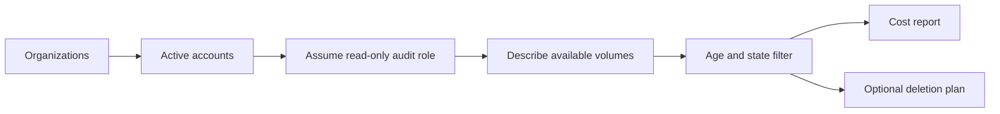

# Design document: Unattached EBS volume audit

## Problem

An organization can accumulate EBS volumes in the `available` state after instances are removed. Those volumes continue to incur storage cost, and the inventory is spread across member accounts.

## Goal

Find old unattached volumes, estimate their monthly cost, and produce a review list without deleting anything.

## Design



- Live mode discovers active accounts through Organizations and assumes `EbsAuditRole` with STS.
- Each account is queried through EC2 `describe_volumes`.
- Only volumes with state `available` and a creation time older than the threshold become report rows.
- Cost uses a visible, configurable estimate per GiB-month.
- The deletion plan is a JSON review list. The tool never calls `delete-volume`.
- Fixture mode uses AWS-shaped JSON so the decision logic can run without credentials.

## Verification

```bash
python ebs_audit.py --fixture fixtures/volumes.json --older-than-days 30 \
  --output ebs-report.json --deletion-plan deletion-plan.json
python -m unittest discover -s tests -v
```

The sample finds two old unattached volumes and estimates `$12.00` per month at the sample rate.

## Risks and limits

The estimate is not a billing statement. A production rollout should confirm volume type pricing by region, add tags and owner metadata, and require an approval workflow before any deletion system consumes the plan.

